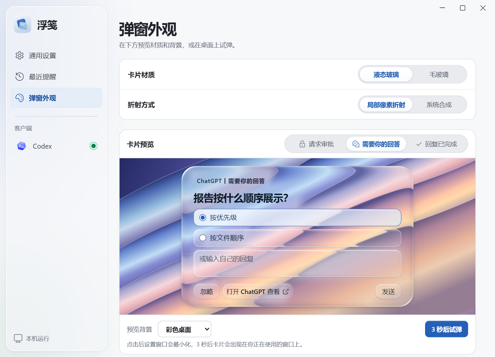
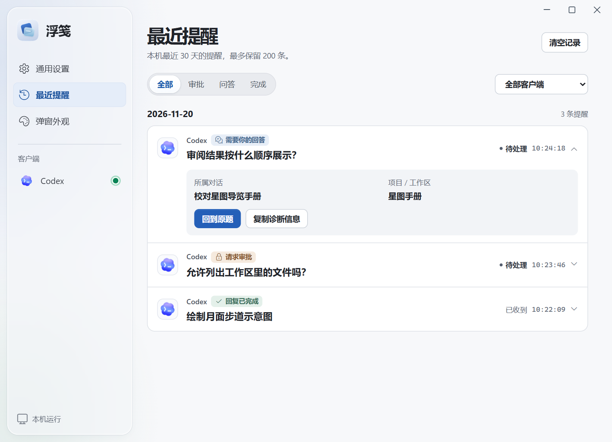

# 浮笺 FloatNotify

浮笺是 Windows 上的 Codex 桌面提醒工具。切到别的窗口写东西时，Codex 的回复完成、提问和人工审批仍会出现在眼前。卡片弹出时，键盘焦点留在你正在输入的窗口。

**版本 1.0.5 · Windows x64 · 开发者 Oahiynus**　[查看本版更新](docs/releases/1.0.5.md)

**下载**　[Windows x64 安装包](https://github.com/Oahiynus/FloatNotify/releases/download/v1.0.5/FloatNotify-1.0.5-windows-x64-Setup.exe) · [.sha256 校验文件](https://github.com/Oahiynus/FloatNotify/releases/download/v1.0.5/FloatNotify-1.0.5-windows-x64-Setup.exe.sha256) · [v1.0.5 Release](https://github.com/Oahiynus/FloatNotify/releases/tag/v1.0.5)

图中是三个虚构任务，使用 1.0.2 安装包中的原生卡片离屏渲染。可以直接处理最前面的审批，也可以点后方问答卡露出的标题，把它翻到前面。

## 安装与首次接入

1. 将 `FloatNotify-1.0.5-windows-x64-Setup.exe` 和同名的 `.sha256` 文件放在同一目录，按[版本说明](docs/releases/1.0.5.md#校验安装包)核对安装包。
2. 双击安装包，按当前 Windows 用户安装。浮笺需要 **.NET 10 桌面运行时（x64）** 和 **Microsoft Edge WebView2 Evergreen 运行时**。缺少运行时时，安装器会提供相应的微软下载页。装好运行时后，再次运行安装包。
3. 如果已经使用过本机 Codex，安装时勾选「接入本机 Codex」。打开 Codex 的「设置 → Hooks」，核对 `Stop` 和 `PermissionRequest` 指向本次安装的 `FloatNotify.exe`，并确认信任。如果之后才开始使用 Codex，可在首次启动 Codex 后，从 Windows 开始菜单选择「FloatNotify → 接入 Codex」。
4. 从开始菜单打开「浮笺」，进入「弹窗外观」，选择一种提醒并点击「3 秒后试弹」。设置窗口会最小化，三秒后卡片出现在当前应用上。关闭设置窗口后，浮笺继续在系统托盘运行。

在浮笺的「客户端 → Codex」页，可以用「启用 Codex 提醒」断开或重新连接。关闭会移除指向本安装的两个 Hook，重新开启会自动添加。若页面提示需要信任，请在 Codex 的 Hooks 设置中确认。三类提醒可以分别开关。

在「通用设置 → 关于」点击「检查更新」。发现新版后，点「更新并重启」，浮笺会下载安装包、校验 SHA-256，并在原安装目录完成更新。若想先了解改动，可点「版本说明」。使用 v1.0.5 正式版时，「查看新版」会打开 GitHub 发布页。

## 收到提醒时

| 卡片 | 可以做什么 |
| --- | --- |
| 回复已完成 | 查看对话名，点「打开 ChatGPT 查看」回到任务，或点 × 收起。切回对应对话时，可见的完成卡也会收起。 |
| 需要你的回答 | 选一个选项或填写自己的回复，然后点「发送」。若按钮显示「打开原题并发送」，浮笺会打开对应对话，核对题目后提交草稿。 |
| 请求审批 | 阅读请求和工作目录，选择「允许一次」或「拒绝」。需要更多上下文时，点「打开 ChatGPT 查看」。点「忽略」可收起提醒，稍后在原对话处理。 |

**同名对话问答卡**　两条 Codex 对话可以用同一个名字，即使其中一条已归档，也能在发题对话里点「发送」。如果当前打开的是另一条同名对话，点「打开原题并发送」，浮笺会保留已选答案，回到发题对话核对题目后提交。这项修复从 1.0.3 起随安装包提供。

几条提醒同时到达时，完成卡会保留完整位置。按住卡片标题或空白处可以拖动，正在输入的问答卡也会保留位置和草稿。屏幕放不下的提醒会折叠到「还有 N 条」，点开即可选择要处理的一条。

## 外观与最近提醒

「弹窗外观」提供液态玻璃、明暗液态玻璃、轻映液态玻璃、柔映液态玻璃、澄光液态玻璃、自适应玻璃和毛玻璃。默认使用液态玻璃，可选择「局部像素折射」或「系统合成」。明暗液态玻璃沿用原版的边缘折射与向内过渡，在暗处降低白色叠加，并随背景提亮文字和图标。轻映液态玻璃沿用明暗液态玻璃，只在标题和问答选项文字与深底亮字重叠处轻微减弱背景笔画。柔映液态玻璃在标题与选项文字周围平滑减弱背景亮笔画，选中行沿圆角向内增加一层更轻的处理。澄光液态玻璃在暗处进一步减轻底色，保留边缘高光，在卡片标题和控件下柔化背景文字。自适应玻璃让深色背景保持深色，文字和图标会根据下方背景切换明暗。可选择「深浅窗口交界」预览横跨两个窗口的效果。像素折射只在卡片显示期间读取其覆盖区域，并在内存中绘制。

在「最近提醒」中可按类型筛选，展开一条记录就能看到所属对话和工作区。待处理的问答或审批可点「回到原题」。开启历史记录时，本机保留最近 30 天内最多 200 条提醒，可在「通用设置」中关闭记录。

默认安装目录为 `%LOCALAPPDATA%\Programs\FloatNotify`，个人设置与提醒历史保存在 `%LOCALAPPDATA%\FloatNotify`。右键托盘图标可退出浮笺。在 Windows「已安装的应用」中卸载时，安装器会移除本次安装的程序和 Hook，保留个人设置与提醒历史。

从源码编译、运行自检和制作安装包请参阅[开发说明](docs/development.md)。

## 许可证与图标

浮笺的自有源码、脚本和文档采用 [MIT 许可证](LICENSE)，版权归 Oahiynus。浮页图标由 Oahiynus 单独保留权利。客户端品牌图标及截图中的对应标识归各自权利人。随附组件的许可、图标的来源和使用范围见[许可与第三方声明](THIRD-PARTY-NOTICES.md)。
